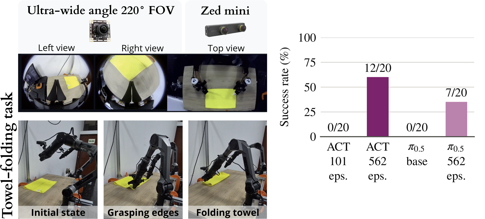
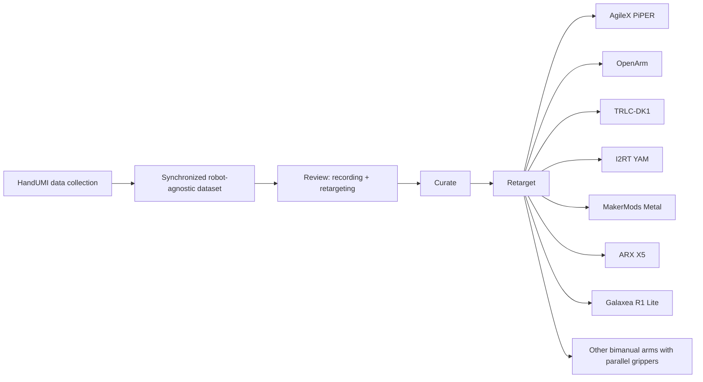
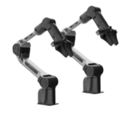
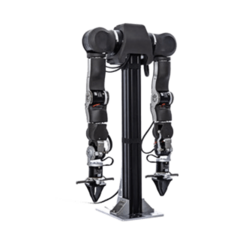
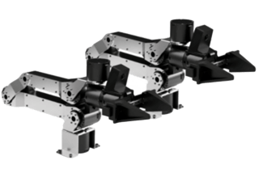
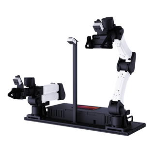

# HandUMI - Software

<p align="center">
  <a href="LICENSE"></a>
  <a href="https://github.com/murobotics-ai/handumi-hw"></a>
  <a href="https://murobotics-ai.github.io/handumi-sw/"></a>
  <a href="https://murobotics.ai/research/handumi"></a>
  <a href="https://huggingface.co/collections/murobotics/handumi-towel-folding-6ad6a18887ac469cd9e20bc7"></a>
</p>

[HandUMI](https://github.com/murobotics-ai/handumi-hw) is a hand-worn interface for collecting robot-free bimanual demonstrations. This repository contains its synchronized data collection, calibration, validation, replay, teleoperation, and robot-retargeting software.

<p align="center">
  
</p>

> **Collect once, retarget to many robots.** Record demonstrations with HandUMI
> once, then retarget and reuse the same data across different bimanual arms
> with parallel grippers, without recollecting demonstrations for each robot.

## Paper

**HandUMI: A Modular Hand-Worn Parallel-Jaw Interface for Robot-Free Bimanual
Data Capture**  
Brik Meza, Leonardo Perez, Alvaro Mendoza, Aniela Ubillus, Mitshell Ramos,
Raul Bastidas, Mauricio Olivera, Bryan Bastidas

[Project website](https://murobotics.ai/research/handumi) ·
[Hardware](https://github.com/murobotics-ai/handumi-hw) ·
[Data and checkpoints](https://huggingface.co/collections/murobotics/handumi-towel-folding-6ad6a18887ac469cd9e20bc7)

This repository is the capture, calibration and retargeting software used in
the paper. On bimanual towel folding, 562 robot-free HandUMI demonstrations
(111.9 min, no robot-collected data) were retargeted to AgileX PiPER arms and
used to train policies that fold the towel on the real robot: ACT succeeds in
12/20 attempts and fine-tuned π0.5 in 7/20, while ACT trained on the first 101
demonstrations and π0.5 without fine-tuning succeed in none.

<p align="center">
  
</p>

The same recordings retarget in simulation to the seven bimanual arms listed
under [Supported Bimanual Embodiments](#supported-bimanual-embodiments) with
sub-millimeter median IK position error. See the paper for the
capture-alignment, calibration and retargeting results.

## Quick Start

Requires [uv](https://docs.astral.sh/uv/) and Python 3.12 or newer.

```bash
git clone https://github.com/murobotics-ai/handumi-sw.git
cd handumi-sw
bash install.sh
source .venv/bin/activate
cp configs/rig.example.yaml configs/rig.yaml
handumi doctor
handumi record --output-dir outputs/my-first-dataset --dry-run
```

PICO support is installed by default. Use `bash install.sh --skip-xrt` for a Meta Quest-only workstation.
Edit `configs/rig.yaml` once with the local cameras, tracking device and robot
profile. `handumi setup --check` prints the same read-only readiness checklist
as `handumi doctor`; `handumi setup` runs the guided hardware setup. Existing
workflows are grouped under the single `handumi` command; use `handumi --help`
to see the final command tree. Bash, Zsh, and Fish completion is loaded when
the virtual environment is activated, so `handumi re<Tab>` completes `record`
and `replay`. The shorter `hu` executable is an equivalent alias, so commands
such as `hu record` use the same interface and completion.

## Install from GitHub

HandUMI can also be installed directly from this repository:

```bash
pip install "handumi @ git+https://github.com/murobotics-ai/handumi-sw.git"
```

Optional robot and simulation backends can be selected with extras:

```bash
pip install "handumi[sim,piper,openarm] @ git+https://github.com/murobotics-ai/handumi-sw.git"
```

For reproducible environments, pin a branch, tag, or commit:

```toml
dependencies = [
    "handumi @ git+https://github.com/murobotics-ai/handumi-sw.git@main",
]
```

## Core Workflow



Raw captures remain robot-agnostic. After collecting data with HandUMI, the same
demonstrations can be retargeted to different bimanual arms with parallel
grippers. `handumi dataset qa` reviews a recording and how a given robot
retargets it, curation removes what the review rejects, and conversion then
executes that decision rather than judging it again.

Before training, `handumi replay-real` streams a converted dataset to the
physical robot through the same backend `teleop-real` uses and reports how
closely the arms followed it, so the data that reaches a policy has already
run on the hardware.

Robot configuration and physical controller-to-TCP calibration are fingerprinted
in dataset metadata, so a converted dataset records exactly which geometry and
calibration produced it. Conversion reuses the trajectories the review solved,
which is what makes its output reproducible: the solver warm-starts each frame
from the previous one, so re-solving from scratch lands on a slightly different
answer for a small fraction of frames.

## Supported Bimanual Embodiments

HandUMI is optimized for fixed-base bimanual manipulators equipped with
parallel-jaw grippers. Demonstrations remain robot-agnostic, so support for new
embodiments can be added without changing the capture format.

| Bimanual | Repository | Preview |
|---|---|---|
| AgileX PiPER | [Repository](https://github.com/agilexrobotics/piper_ros) |  |
| OpenArm | [Repository](https://github.com/enactic/openarm) |  |
| TRLC-DK1 | [Repository](https://github.com/robot-learning-co/trlc-dk1) |  |
| I2RT YAM | [Repository](https://github.com/i2rt-robotics/i2rt) |  |
| MakerMods Metal | [Repository](https://github.com/makermods-robotics/metal-python-ros) | — |
| ARX X5 | [Repository](https://github.com/ARXroboticsX/ARX_X5) | — |
| Galaxea R1 Lite | [Product page](https://galaxea-dynamics.com/products/galaxea-r1-lite-6-drof-general-mobile-manipulation-platform) | — |

**More embodiments coming soon.** See
[Add a new robot embodiment](https://murobotics-ai.github.io/handumi-sw/development/new_embodiment.html)
to contribute an integration. If you want support for a specific bimanual arm,
[open an embodiment request](https://github.com/murobotics-ai/handumi-sw/issues/new).

## Supported Scope

**Single-arm Panda:** use `--robot franka_emika_panda` to record with only the right
HandUMI, then review, convert and replay on the Franka Emika Panda model from
Google DeepMind MuJoCo Menagerie. See the [Panda workflow](docs/source/workflows/franka_emika_panda.md).
Physical Franka control is not implemented.

- Tracking: PICO 4 Ultra through XRoboToolkit and Meta Quest 3/3S through
  [HandUMI Quest App](https://github.com/murobotics-ai/handumi-quest-app).
- Robot models and simulation: AgileX PiPER, OpenArm, TRLC-DK1, Axol, I2RT
  YAM, MakerMods Metal, ARX X5, Galaxea R1 Lite, and single-arm Franka Panda.
- Real-robot teleoperation: AgileX PiPER and OpenArm through optional backends.
- Dataset format: LeRobot-compatible synchronized captures.
- Episode control: hands-free by voice ("start recording", "stop recording",
  "restart"), recognized offline; gripper double-squeezes and PICO buttons
  remain available.

## Safety

This is research software. Preview and validate trajectories before commanding physical robots, keep an emergency stop accessible, and enforce the robot's joint, velocity, acceleration, workspace, and collision limits.

## Credits

HandUMI builds on UMI, HandUMI Quest App, XRoboToolkit, LeRobot, PyRoki,
Viser, Rerun, and MuJoCo. See the [documentation](https://murobotics-ai.github.io/handumi-sw/)
and [LICENSE](LICENSE) for attribution and third-party licensing details.

Project lead and original hardware design: [BrikHMP18](https://github.com/BrikHMP18). Core software contributors include [Leonardo Pérez](https://github.com/leoperezz), [Raul Bastidas](https://github.com/raulbastidas1203), [Mitshell Ramos](https://github.com/mbrq13), and [Alvaro Mendoza-Li](https://github.com/alvax64).

We thank the NONHUMAN community for their collaboration on data collection
and device testing.

## Citation

If you use HandUMI, please cite:

```bibtex
@misc{meza2026handumi,
  title  = {{HandUMI}: A Modular Hand-Worn Parallel-Jaw Interface for
            Robot-Free Bimanual Data Capture},
  author = {Meza, Brik and Perez, Leonardo and Mendoza, Alvaro and
            Ubillus, Aniela and Ramos, Mitshell and Bastidas, Raul and
            Olivera, Mauricio and Bastidas, Bryan},
  year   = {2026},
  url    = {https://murobotics.ai/research/handumi}
}
```

## License

Original HandUMI software and documentation are licensed under the [Apache License 2.0](LICENSE). Dataset, hardware, headset application, robot firmware, and trademark licenses remain separate.
